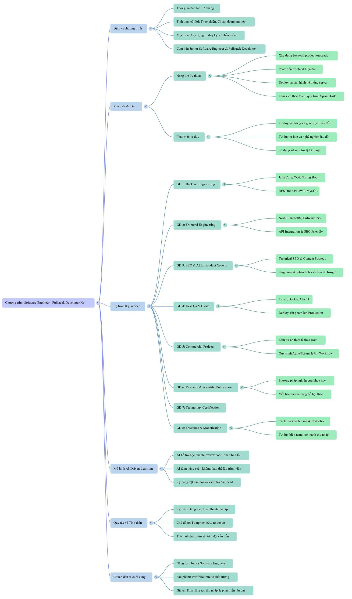

# Hành trình học Software Engineer & Fullstack Developer

Repo này lưu lại quá trình học, thực hành và xây dựng sản phẩm của mình theo chương trình **Software Engineer – Fullstack Developer**. Đây là nơi mình ghi chép kiến thức, lưu bài tập, dự án và nhìn lại sự tiến bộ qua từng giai đoạn.

> **Trạng thái hiện tại:** Đang học DevOps ở giai đoạn đầu. Repo sẽ được bổ sung ghi chú và bài thực hành trong quá trình học.

## Mục tiêu

- Xây dựng nền tảng lập trình và tư duy giải quyết vấn đề.
- Phát triển ứng dụng fullstack, từ giao diện đến API, cơ sở dữ liệu và triển khai.
- Rèn luyện cách làm việc với Git, quy trình nhóm và kỹ năng tự học.
- Hoàn thiện các dự án thực tế để đưa vào portfolio.

Theo sơ đồ chương trình, lộ trình dự kiến kéo dài **15 tháng** và gồm 8 giai đoạn:

| Giai đoạn | Nội dung chính | Tiến độ |
| --- | --- | --- |
| 1. Backend Engineering | Java Core, OOP, Spring Boot, RESTful API, JWT, MySQL | Chưa bắt đầu |
| 2. Frontend Engineering | ReactJS, NextJS, Tailwind CSS, tích hợp API và SEO | Chưa bắt đầu |
| 3. SEO & AI for Product Growth | Technical SEO, chiến lược nội dung, ứng dụng AI để phân tích | Chưa bắt đầu |
| 4. DevOps & Cloud | Linux, Docker, CI/CD và triển khai sản phẩm | Đang học (giai đoạn đầu) |
| 5. Commercial Projects | Dự án nhóm, Agile/Scrum và Git workflow | Chưa bắt đầu |
| 6. Research & Scientific Publication | Phương pháp nghiên cứu, viết báo cáo và công bố | Chưa bắt đầu |
| 7. Technology Certification | Chuẩn bị và hoàn thành các chứng chỉ công nghệ | Chưa bắt đầu |
| 8. Freelance & Monetization | Portfolio, tìm khách hàng và phát triển nguồn thu nhập | Chưa bắt đầu |

## Sơ đồ lộ trình

