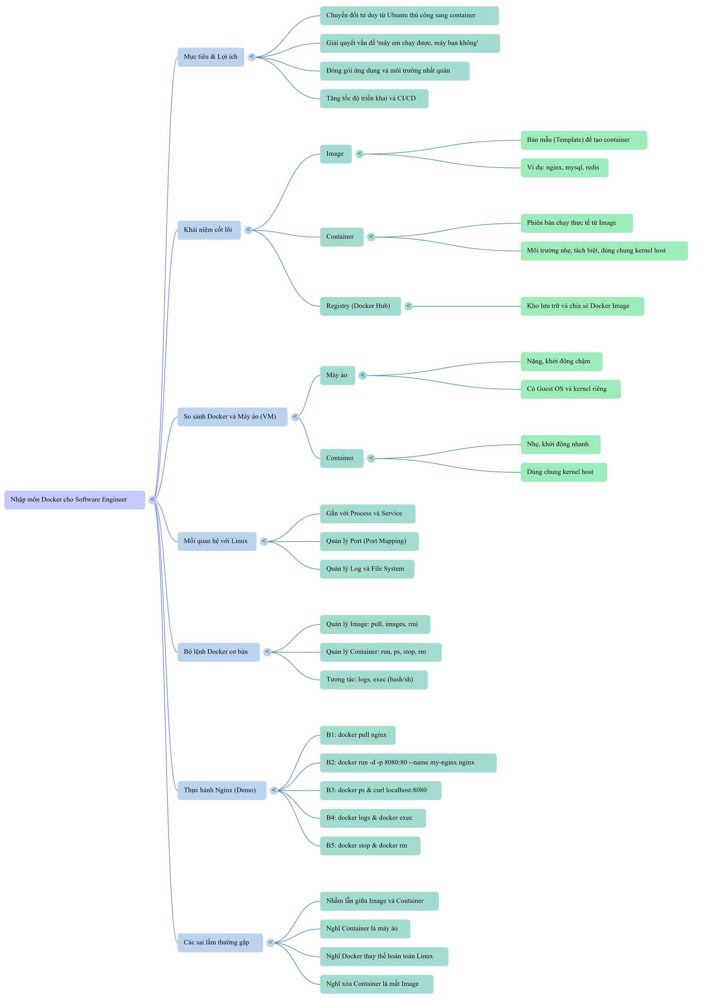

# 1. Tổng quan Docker

[← Mục lục](README.md) · [Tiếp: Các lệnh cơ bản →](02-lenh-co-ban.md)

## Vì sao dev cần Docker?

Ứng dụng có thể gặp những tình huống quen thuộc:

- Chạy được trên máy bạn nhưng không chạy trên máy đồng đội.
- Chạy ổn ở local nhưng lỗi khi đưa lên server.
- Cần đúng phiên bản Java, Node.js hoặc thư viện mà máy khác chưa có.

Nguyên nhân có thể nằm ở **môi trường chạy**: phiên bản runtime, thư viện hoặc cấu hình khác nhau.

Docker giúp đóng gói ứng dụng cùng các thành phần cần thiết để chạy lại và triển khai nhất quán hơn. Ứng dụng vẫn cần code, cấu hình, mạng và dữ liệu phù hợp để hoạt động đúng.

**Tư duy cần có:** Từ viết code chạy trên máy mình sang chuẩn bị một môi trường chạy rõ ràng để người khác có thể sử dụng.

## Docker là gì?

**Docker** là nền tảng hỗ trợ đóng gói, phân phối và chạy ứng dụng bằng **container**.

Ví dụ, một hệ thống có thể dùng các container riêng cho backend Java, frontend Node.js, Nginx và MySQL. Mỗi thành phần có môi trường cần thiết của nó, giúp giảm việc cài mọi thứ trực tiếp lên máy.

## Container là gì?

**Container** là môi trường chạy ứng dụng được cách ly tương đối với bên ngoài. Bên trong có tiến trình, hệ thống tệp và môi trường mạng; ứng dụng có thể mở cổng và ghi log.

Có thể hình dung container như một chiếc hộp chạy ứng dụng cùng những thành phần cần thiết:

- Container Nginx phục vụ web.
- Container MySQL chạy cơ sở dữ liệu.
- Container Redis chạy dịch vụ lưu trữ dữ liệu trong bộ nhớ.
- Container backend chạy ứng dụng Java, Python hoặc Node.js.

Container được tạo từ image. Một container có thể **đang chạy hoặc đã dừng**; dừng container chưa phải là xóa nó.

Container chạy khi tiến trình chính bên trong còn hoạt động. Tiến trình chính kết thúc thì container dừng, kể cả khi dùng `-d` để chạy nền.

## Image là gì?

**Image** là bản mẫu chỉ đọc dùng để tạo container. Nó chứa các tệp, chương trình, thư viện và cấu hình cần cho ứng dụng.

Ví dụ, image của backend Java có thể chứa runtime Java, tệp ứng dụng và các thành phần phụ thuộc. Image `nginx` chứa Nginx và môi trường để chạy nó.

| Khái niệm | Cách hiểu |
| --- | --- |
| Image | Khuôn mẫu để tạo container. |
| Container | Một phiên bản cụ thể được tạo từ image, có trạng thái và dữ liệu riêng. |

Một image có thể tạo nhiều container. Chạy `docker run nginx` sẽ tạo và khởi động một container mới từ image Nginx; nếu chưa có image trên máy, Docker sẽ tải về.

Tên image có thể kèm **tag**, ví dụ `nginx:latest`: `nginx` là tên, `latest` là nhãn. Nếu không ghi tag, Docker mặc định dùng `latest`; nhãn này có thể được cập nhật sang image khác theo thời gian.

## Docker Hub và registry

**Registry** là nơi lưu trữ và phân phối image. **Docker Hub** là registry mặc định, có các image như Nginx, MySQL, Redis và Node.js.

```text
Docker Hub → pull → image trên máy → run → container
```

`docker pull nginx` tải image về máy. Image ứng dụng của bạn có thể được tạo từ mã nguồn và môi trường mà ứng dụng cần.

## Docker khác máy ảo thế nào?

VMware Workstation hoặc VirtualBox tạo máy ảo có phần cứng ảo và hệ điều hành guest riêng. Container tập trung vào môi trường chạy ứng dụng.

| Tiêu chí | Máy ảo | Container Linux |
| --- | --- | --- |
| Kernel | Có kernel của hệ điều hành guest. | Chia sẻ kernel của môi trường Linux chạy container. |
| Tài nguyên | Thường cần nhiều RAM và dung lượng hơn. | Thường nhẹ hơn vì không cần khởi động cả hệ điều hành guest riêng. |
| Khởi động | Khởi động hệ điều hành guest. | Khởi động tiến trình ứng dụng. |
| Mục đích | Chạy một môi trường máy tính với hệ điều hành riêng. | Chạy ứng dụng và dịch vụ trong môi trường cách ly. |

Với Docker Desktop trên Windows hoặc macOS, container Linux thường chạy thông qua một môi trường Linux trong máy ảo. Chúng chia sẻ kernel của môi trường Linux đó.

## Sơ đồ ôn tập

[](../img/docker-fundamentals-mindmap.png)
