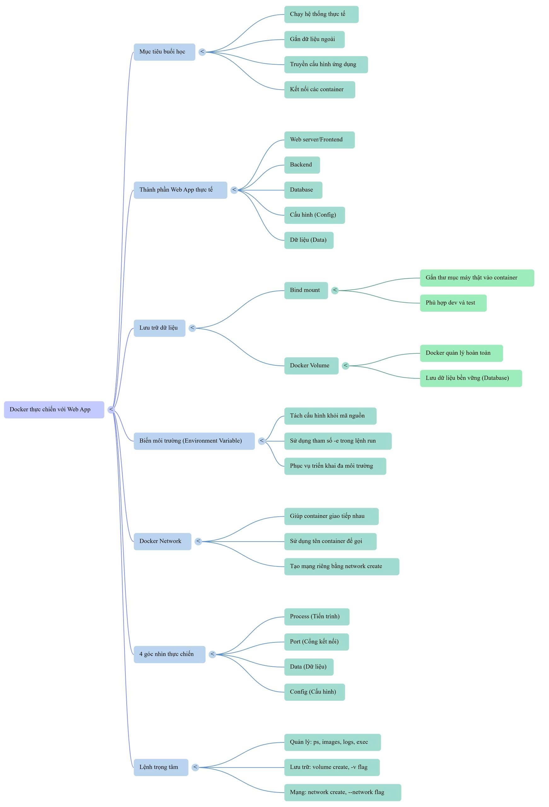

# Docker căn bản cho Software Engineer

Docker giúp đóng gói, chạy và triển khai ứng dụng với môi trường rõ ràng hơn. Bộ ghi chú này tập trung vào các khái niệm và lệnh đầu tiên dùng trong công việc dev.

## Học theo thứ tự

| Bài | Nội dung | Dùng để làm gì? |
| --- | --- | --- |
| [1. Tổng quan Docker](01-tong-quan.md) | Docker, container, image, Docker Hub, so sánh máy ảo | Hiểu ứng dụng được đóng gói và chạy như thế nào. |
| [2. Các lệnh cơ bản](02-lenh-co-ban.md) | `pull`, `images`, `run`, `ps`, `logs`, `exec`, `start`, `stop`, `rm` | Chạy Nginx, kiểm tra và quản lý container. |
| [3. Volume và bind mount](03-volume-va-bind-mount.md) | Gắn thư mục HTML vào Nginx, giữ dữ liệu MySQL bằng named volume | Hiểu dữ liệu nằm ở đâu và cách dùng lại khi thay container. |
| [4. Env và network](04-env-va-network.md) | `-e`, `--network`, gọi container bằng tên | Tách cấu hình khỏi code và kết nối các thành phần của web app. |

Ví dụ bài 2 dùng image `nginx:latest`, container tên `03112026` và cổng host `8080`. Bài 3 dùng thêm Nginx và MySQL để thực hành lưu dữ liệu.

## Lệnh trọng tâm để tra nhanh

Thay `TEN` bằng tên container của bạn.

| Lệnh | Tác dụng |
| --- | --- |
| `docker pull nginx` | Tải image Nginx về máy. |
| `docker ps` / `docker ps -a` | Xem container đang chạy / tất cả container. |
| `docker images` | Xem image trên máy. |
| `docker logs TEN` | Xem log container. |
| `docker exec -it TEN bash` | Mở Bash trong container đang chạy; dùng `sh` nếu image chỉ có `sh`. |
| `docker start TEN` / `docker stop TEN` | Chạy lại / dừng container. |
| `docker restart TEN` | Khởi động lại container đã tồn tại. |
| `docker rm TEN` | Xóa container đã dừng. |
| `docker volume create mysql1011-data` | Tạo named volume. |
| `docker volume ls` | Xem danh sách volume. |
| `docker volume inspect mysql1011-data` | Xem thông tin volume. |
| `docker network create tienkientoan` | Tạo network cho các container. |
| `docker network ls` | Xem danh sách network. |

### Chạy với bind mount

Bind mount không có lệnh `docker bind create`: tạo thư mục trên host bằng `mkdir`, rồi gắn nó khi chạy container. Ví dụ trong Bash trên Linux:

```bash
mkdir -p ~/05112026
echo '<h1>Hello Docker</h1>' > ~/05112026/index.html
docker run -d --name web-demo05 -p 8080:80 -v "$HOME/05112026:/usr/share/nginx/html:ro" nginx:latest
```

Mở `http://localhost:8080`. Sửa HTML trên host rồi tải lại trang để thấy thay đổi. `:ro` cho Nginx đọc thư mục đã gắn.

### Chạy với volume, env và network

Sau khi tạo volume `mysql1011-data` và network `tienkientoan` bằng các lệnh trong bảng trên:

```bash
docker run -d --name mysql1011 \
  --network tienkientoan \
  -e MYSQL_ROOT_PASSWORD='LabOnly_1011' \
  -e MYSQL_DATABASE=kienpham \
  -e MYSQL_USER=kienapp \
  -e MYSQL_PASSWORD='AppOnly_1011' \
  -v mysql1011-data:/var/lib/mysql \
  mysql:8.4
```

`-v` gắn volume lưu dữ liệu, `-e` truyền cấu hình khởi tạo, `--network` chọn mạng. Mật khẩu chỉ dùng cho lab. Đây là các mẫu của bài 3–4: cần tên container chưa được dùng và cổng host còn trống khi publish.

## Sơ đồ Docker thực chiến

[](../img/docker-web-app-mindmap.png)

**Tham khảo:** [Khái niệm Docker](https://docs.docker.com/get-started/docker-concepts/) · [Docker CLI](https://docs.docker.com/reference/cli/docker/).
