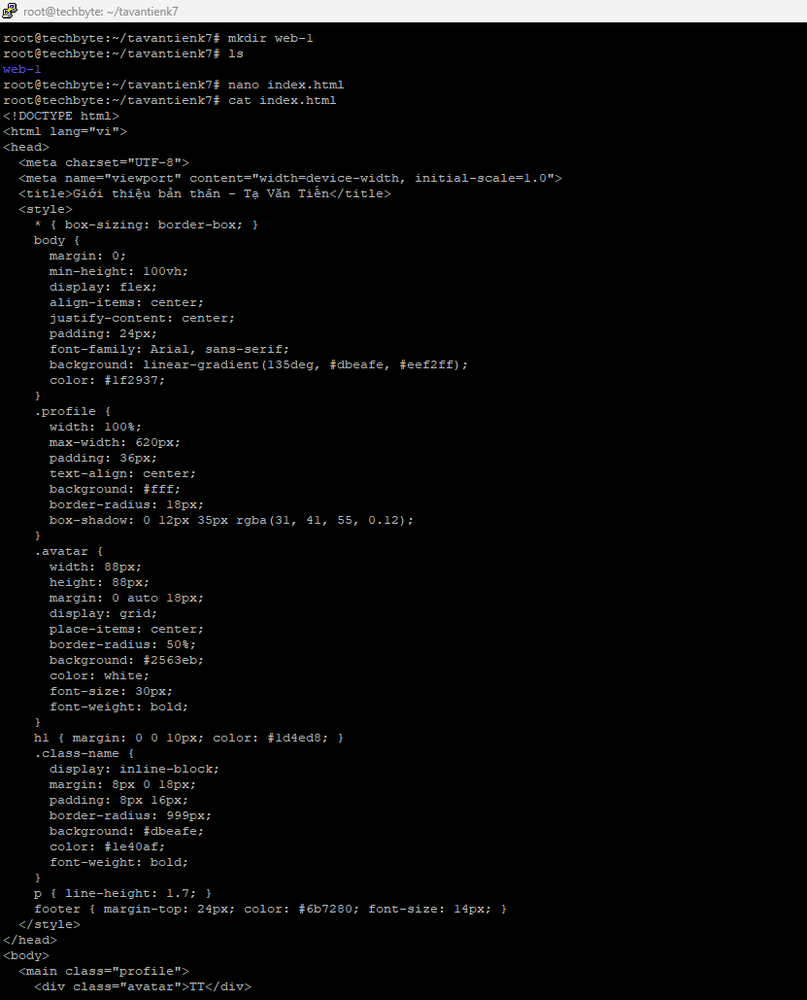
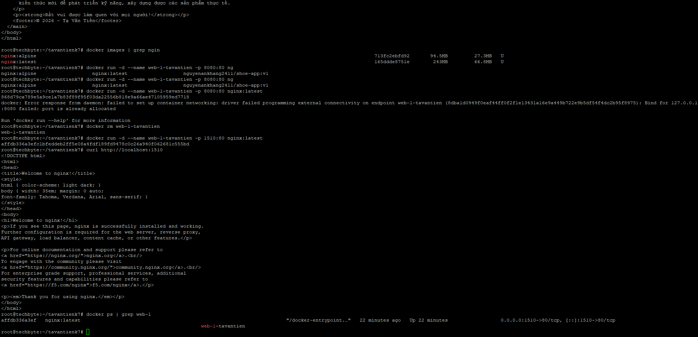
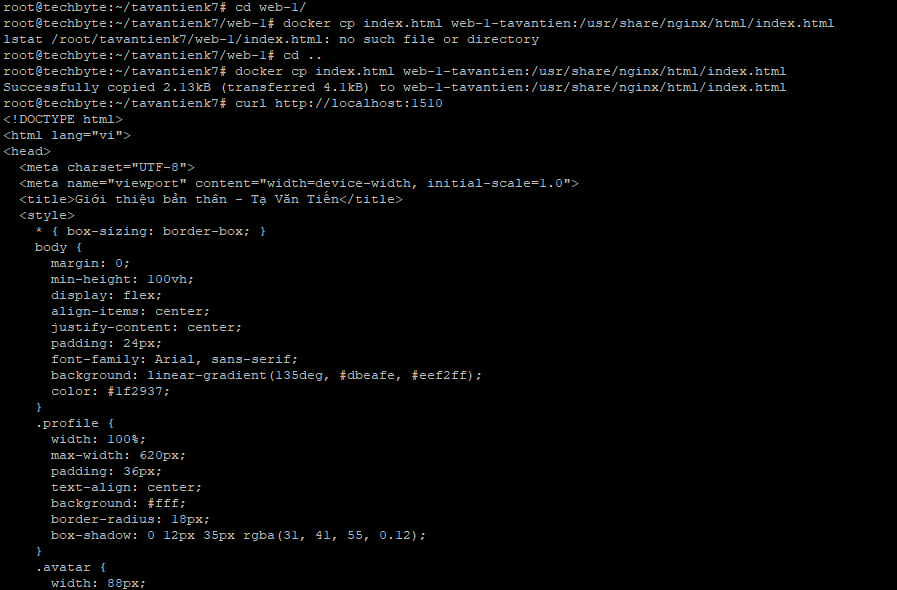

# Bài 01: Chạy Nginx bằng Docker

## Tạo trang HTML

```bash
cd ~/tavantienk7
mkdir -p web-1
nano index.html
cat index.html
```



## Chạy container

```bash
docker images | grep nginx
docker run -d --name web-1-tavantien -p 8080:80 nginx:latest
```

Cổng `8080` bị trùng (`port is already allocated`), đổi sang `1510`:

```bash
docker rm web-1-tavantien
docker run -d --name web-1-tavantien -p 1510:80 nginx:latest
```

## Kiểm tra

```bash
curl http://localhost:1510
docker ps | grep web-1
```

**Kết quả trong ảnh:** Container chạy, cổng `1510` trả về `Welcome to nginx!`.



## Chép HTML vào container

```bash
docker cp index.html web-1-tavantien:/usr/share/nginx/html/index.html
curl http://localhost:1510
```

**Kết quả:** Chép thành công; `curl` trả về trang `Giới thiệu bản thân - Tạ Văn Tiến`.


