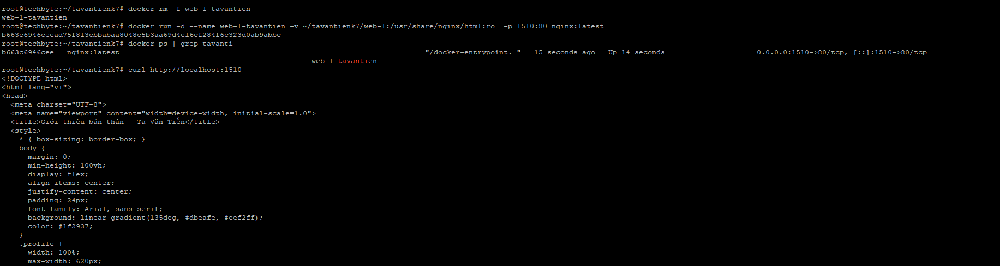
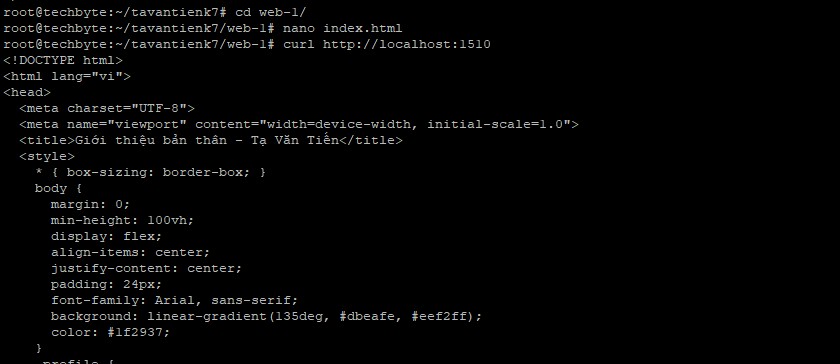

# Bài 02: Bind mount HTML vào Nginx

File `index.html` nằm trong `~/tavantienk7/web-1` trên máy chủ.

## Chạy container với bind mount

```bash
docker rm -f web-1-tavantien
docker run -d --name web-1-tavantien -v ~/tavantienk7/web-1:/usr/share/nginx/html:ro -p 1510:80 nginx:latest
docker ps | grep tavanti
curl http://localhost:1510
```

**Kết quả:** Container chạy ở cổng `1510`, trả về trang giới thiệu Tạ Văn Tiến. `:ro` chỉ cho container đọc thư mục được mount.



## Sửa HTML trên máy chủ

```bash
cd ~/tavantienk7/web-1
nano index.html
curl http://localhost:1510
```

Nginx đọc trực tiếp file đã lưu trên máy chủ, không cần `docker cp` hay tạo lại container.


