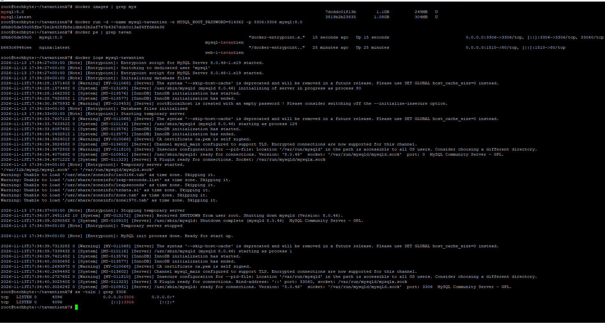

# Bài 03: Chạy MySQL bằng Docker

## Chạy container

Thay `YOUR_ROOT_PASSWORD` bằng mật khẩu của bạn.

```bash
docker images | grep mysql
docker run -d --name mysql-tavantien -e MYSQL_ROOT_PASSWORD='YOUR_ROOT_PASSWORD' -p 3306:3306 mysql:8.0
```

## Kiểm tra

```bash
docker ps | grep tavan
docker logs mysql-tavantien
ss -tuln | grep 3306
```

**Kết quả trong ảnh:** Container `mysql-tavantien` ở trạng thái `Up`, MySQL báo `ready for connections` tại cổng `3306`. Máy chủ lắng nghe trên `0.0.0.0:3306` và `[::]:3306`.

Các warning không ngăn MySQL khởi chạy. Cảnh báo root có mật khẩu rỗng xuất hiện lúc khởi tạo; entrypoint đặt mật khẩu ở bước tiếp theo. [Mã nguồn entrypoint](https://github.com/docker-library/mysql/blob/master/docker-entrypoint.sh).



## Bổ sung: kiểm tra đăng nhập

đăng nhập

```bash
docker exec -it mysql-tavantien mysql -u root -p
```
