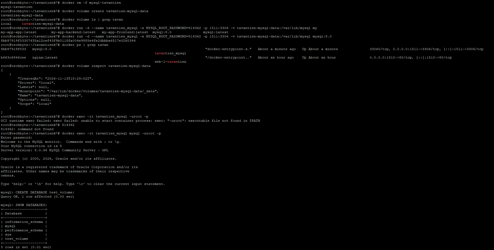
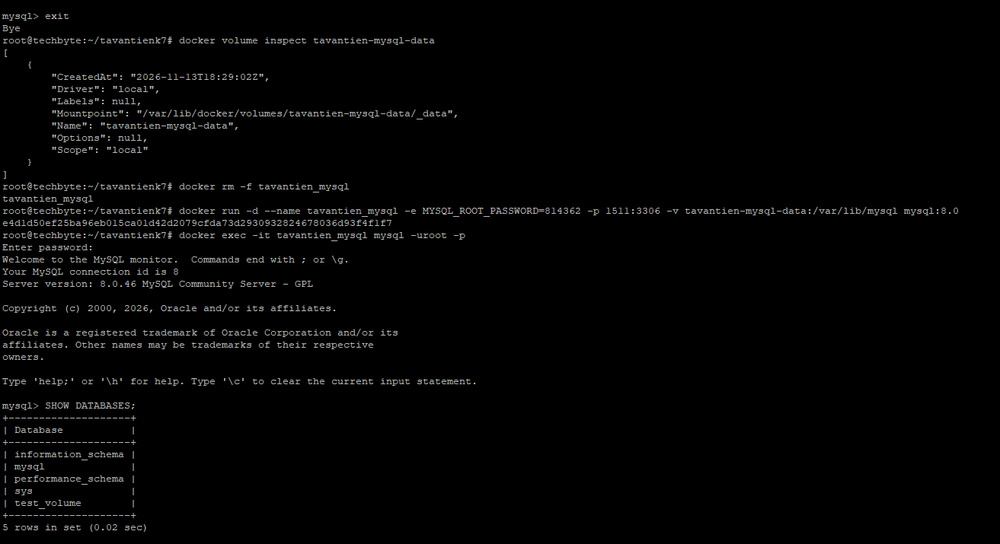

# Bài 04: Lưu dữ liệu MySQL bằng Docker volume

Thay `YOUR_ROOT_PASSWORD` bằng mật khẩu của bạn, dùng cùng mật khẩu khi tạo lại container.

## Tạo volume và chạy MySQL

```bash
docker rm -f mysql-tavantien
docker volume create tavantien-mysql-data
docker volume ls | grep tavan
docker run -d --name tavantien_mysql -e MYSQL_ROOT_PASSWORD='YOUR_ROOT_PASSWORD' -p 1511:3306 -v tavantien-mysql-data:/var/lib/mysql mysql:8.0
docker ps | grep tavan
docker volume inspect tavantien-mysql-data
```

**Kết quả:** Container `tavantien_mysql` chạy ở cổng host `1511`, gắn volume `tavantien-mysql-data` vào `/var/lib/mysql`.

## Tạo database kiểm tra

```bash
docker exec -it tavantien_mysql mysql -uroot -p
```

Nhập mật khẩu, rồi chạy:

```sql
CREATE DATABASE test_volume;
SHOW DATABASES;
exit
```

**Kết quả:** Tạo thành công database `test_volume`.



## Xóa và tạo lại container với cùng volume

```bash
docker volume inspect tavantien-mysql-data
docker rm -f tavantien_mysql
docker run -d --name tavantien_mysql -e MYSQL_ROOT_PASSWORD='YOUR_ROOT_PASSWORD' -p 1511:3306 -v tavantien-mysql-data:/var/lib/mysql mysql:8.0
docker exec -it tavantien_mysql mysql -uroot -p
```

Nhập mật khẩu, rồi kiểm tra:

```sql
SHOW DATABASES;
```

**Kết quả:** Database `test_volume` vẫn tồn tại sau khi xóa và tạo lại container.



## Vì sao database cần volume

Database cần volume để lưu dữ liệu độc lập với container.<br>
Khi xóa container, dữ liệu trong volume vẫn được giữ lại.<br>
Container mới gắn cùng volume có thể tiếp tục sử dụng dữ liệu cũ.<br>
Volume giúp việc quản lý và sao lưu dữ liệu thuận tiện hơn.
