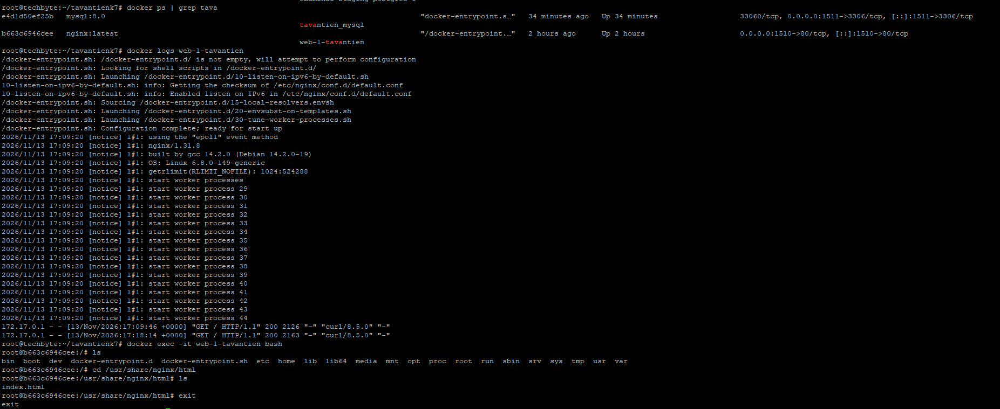
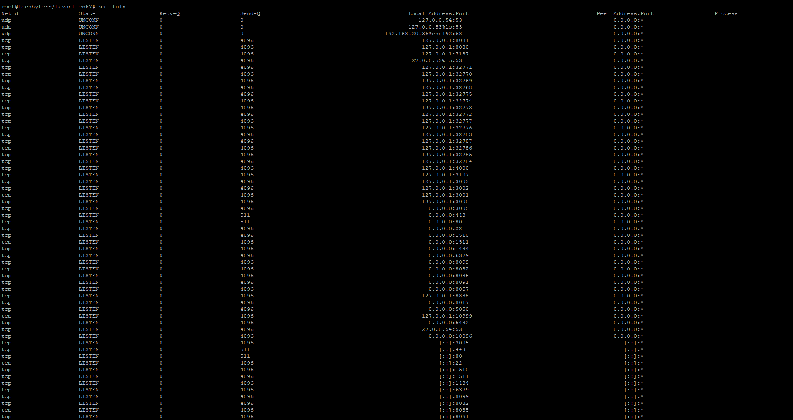
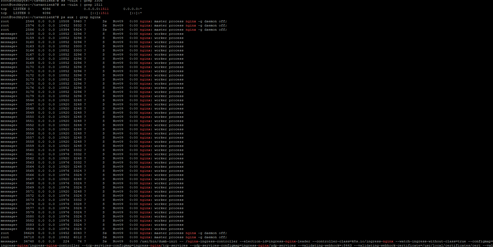

# Bài 05: Kiểm tra container như một service

## Kiểm tra container và log

```bash
docker ps | grep tava
docker logs web-1-tavantien
```

**Kết quả:** Nginx và MySQL đều `Up`. Nginx map `1510:80`, MySQL map `1511:3306`. Log Nginx có các request trả về HTTP `200`.

## Kiểm tra bên trong container

```bash
docker exec -it web-1-tavantien bash
ls
cd /usr/share/nginx/html
ls
exit
```

**Kết quả:** Thư mục `/usr/share/nginx/html` có file `index.html`.



## Kiểm tra port trên host

```bash
ss -tuln
```

**Kết quả:** Host đang lắng nghe cổng `1510` và `1511` trên IPv4 và IPv6.



## Kiểm tra process trên host

```bash
ss -tuln | grep 1511
ps aux | grep nginx
```

**Kết quả:** Cổng `1511` ở trạng thái `LISTEN`; danh sách process có các tiến trình Nginx.



Để bổ sung minh chứng tiến trình Docker trên host, chạy và chụp thêm:

```bash
ps aux | grep -E '[d]ockerd|[c]ontainerd|[d]ocker-proxy'
```
