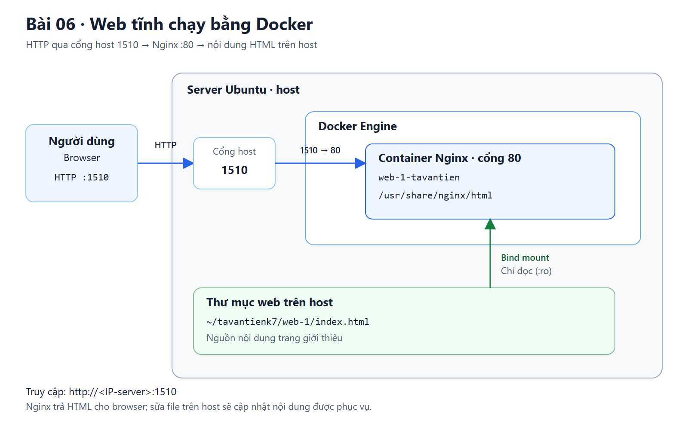

# Bài 06: Sơ đồ web tĩnh chạy bằng Docker

Browser truy cập `http://<IP-server>:1510` → Nginx trong container `web-1-tavantien` ở cổng `80`. Nginx đọc file từ `~/tavantienk7/web-1` qua bind mount vào `/usr/share/nginx/html` ở chế độ chỉ đọc.

[Bản SVG](img/bai-06-static-web.svg)
