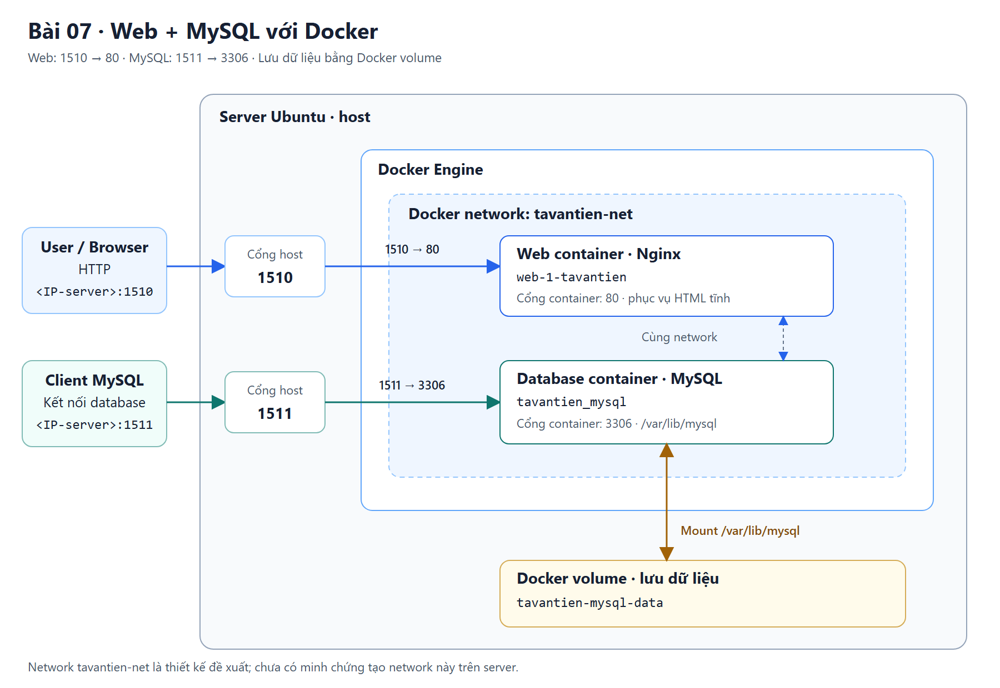

# Bài 07: Sơ đồ web + MySQL với Docker

- Web: `web-1-tavantien`, cổng host `1510` → cổng container `80`.
- MySQL: `tavantien_mysql`, cổng host `1511` → cổng container `3306`.
- Volume: `tavantien-mysql-data` → `/var/lib/mysql`, giữ dữ liệu khi tạo lại container.
- Network đề xuất: `tavantien-net`, cho hai container cùng mạng. Chưa có minh chứng tạo network này trên server.

Mũi tên nét đứt thể hiện cùng mạng; Nginx phục vụ HTML tĩnh, không trực tiếp truy vấn MySQL.

[Bản SVG](img/bai-07-web-mysql.svg)
