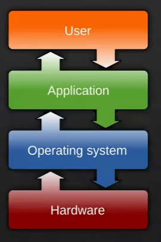

# 1. Tổng quan Linux

[← Mục lục](README.md) · [Tiếp: Hệ thống tệp →](02-he-thong-tep.md)

Linux là môi trường chạy ứng dụng thường gặp trên máy chủ (server) và cloud. Với Software Engineer, hiểu Linux giúp bạn triển khai ứng dụng, theo dõi hoạt động và tìm nguyên nhân khi có sự cố.

Trong công việc, bạn có thể cần:

- Kết nối đến server bằng SSH và triển khai ứng dụng.
- Đọc log, kiểm tra tiến trình, CPU, RAM và dung lượng ổ đĩa.
- Kiểm tra quyền truy cập tệp, kết nối mạng và cổng (port) của dịch vụ.
- Cấu hình Nginx, chạy Docker và phối hợp xử lý sự cố với người phụ trách vận hành.

**Mục tiêu:** Hiểu ứng dụng chạy trên môi trường nào, sử dụng những tài nguyên gì và cách kiểm tra khi gặp lỗi.

## Hệ điều hành là gì?



**Hệ điều hành (Operating System, OS)** là phần mềm hệ thống quản lý phần cứng, tài nguyên máy tính và cung cấp môi trường cho các chương trình hoạt động.

Ví dụ: khi ứng dụng cần đọc tệp hoặc gửi dữ liệu qua mạng, hệ điều hành cung cấp các dịch vụ để thực hiện những công việc đó.

## Linux, kernel và bản phân phối

**Kernel (nhân)** là phần lõi của hệ điều hành. **Linux là một kernel**; trong cách gọi thông thường, “Linux” cũng chỉ các hệ điều hành được xây dựng quanh kernel này.

**Bản phân phối Linux (distribution, hay distro)** kết hợp Linux kernel với thư viện, công cụ hệ thống, trình quản lý gói và các thành phần cần thiết để cài đặt, sử dụng hệ điều hành.

### Một số bản phân phối

| Bản phân phối | Đặc điểm chính |
| --- | --- |
| Debian | Do cộng đồng phát triển, chú trọng phần mềm tự do và tính ổn định. |
| Ubuntu | Dựa trên Debian, có các phiên bản cho máy cá nhân và server. |
| Red Hat Enterprise Linux (RHEL) | Hướng đến doanh nghiệp, có dịch vụ hỗ trợ thương mại từ Red Hat. |
| CentOS Stream | Nơi phát triển và tích hợp các thay đổi cho những bản cập nhật tiếp theo của RHEL. |
| Kali Linux | Dựa trên Debian, chuyên cho kiểm thử xâm nhập và đánh giá bảo mật. |

### Mã nguồn mở nghĩa là gì?

Phần mềm **mã nguồn mở (open source)** cho phép xem, sử dụng, chỉnh sửa và phân phối lại mã nguồn theo giấy phép đi kèm. Linux kernel là phần mềm mã nguồn mở; khi sử dụng hoặc phân phối, bạn vẫn cần tuân thủ giấy phép.

## Kiến trúc tổng quan hệ thống Linux

Có thể hình dung hệ thống Linux qua sơ đồ đơn giản sau:

```text
Không gian người dùng: ứng dụng, shell, tiện ích, thư viện
                           ↓ Lời gọi hệ thống (system call)
Không gian kernel:     Linux kernel
                           ↓
                        Phần cứng
```

- **Kernel:** Quản lý tiến trình, CPU, bộ nhớ, thiết bị, hệ thống tệp và mạng; thực thi các cơ chế kiểm soát quyền truy cập.
- **Shell:** Chương trình thông dịch lệnh, cho phép chạy chương trình và viết script để tự động hóa công việc. Ví dụ: Bash, Zsh.
- **Ứng dụng và tiện ích:** Các chương trình như Nginx, Python, `ls`, `cat`, phục vụ công việc của người dùng và hệ thống.

Chương trình yêu cầu dịch vụ từ kernel qua **system call**, thường thông qua thư viện. Shell cũng là chương trình trong không gian người dùng; ứng dụng không cần đi qua shell để gọi dịch vụ của kernel.

## Máy ảo và VMware

**Máy ảo (Virtual Machine, VM)** là máy tính được tạo bằng phần mềm, có CPU, RAM, ổ đĩa và thiết bị mạng ảo. Máy chạy nền tảng ảo hóa gọi là **host**; hệ điều hành chạy bên trong máy ảo gọi là **guest OS** và có kernel riêng.

**VMware Workstation** là một công cụ tạo và chạy máy ảo trên máy cá nhân. Bạn có thể dùng nó để cài Ubuntu và thực hành Linux trong một môi trường riêng.

**Phân biệt với container:** Mỗi VM có kernel riêng, còn các container Linux trên cùng một hệ thống chia sẻ kernel của hệ thống đó. Khi chạy container Linux trên Windows hoặc macOS, môi trường Linux này thường nằm trong một máy ảo.

## Tham khảo

- [GNU Bash: Shell là gì?](https://www.gnu.org/software/bash/manual/html_node/What-is-a-shell_003f.html)
- [Linux kernel: Giao tiếp giữa chương trình và kernel](https://www.kernel.org/doc/html/v6.6/process/adding-syscalls.html)
- [Kali Linux: Giới thiệu bản phân phối](https://www.kali.org/docs/introduction/what-is-kali-linux/)
