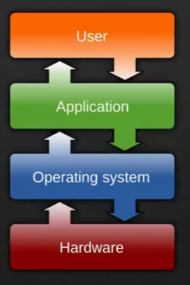
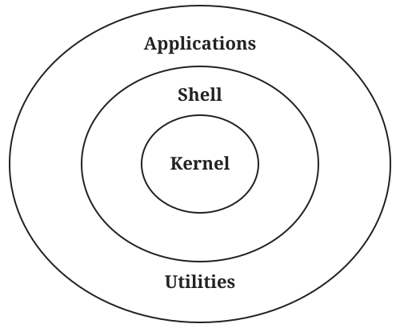

# 1. Tổng quan Linux

[← Mục lục](README.md) · [Tiếp: Hệ thống tệp →](02-he-thong-tep.md)

Khi mới học lập trình, chúng ta thường tập trung vào ngôn ngữ và framework: Java, Python, C#, Spring Boot cho backend; React, Next.js cho frontend; SQL cho cơ sở dữ liệu. Viết xong và chạy được trên máy cá nhân là một bước quan trọng, nhưng ứng dụng còn phải hoạt động ổn định khi đưa cho người khác sử dụng.

Trong công việc, bạn có thể cần:

- Đưa ứng dụng lên server và cho người dùng truy cập qua Internet.
- Đọc log để tìm nguyên nhân lỗi khi ứng dụng đang chạy.
- Kiểm tra tiến trình, bộ nhớ, CPU, ổ đĩa và quyền truy cập tệp.
- Kiểm tra kết nối mạng, địa chỉ IP và cổng (port) của dịch vụ.
- Cấu hình dịch vụ như Nginx, kết nối bằng SSH, chạy Docker.
- Trao đổi với người phụ trách DevOps hoặc vận hành hệ thống.

Nhiều server và môi trường cloud chạy Linux. Vì vậy, hiểu Linux giúp bạn biết **mã của mình chạy ở đâu, phụ thuộc vào những gì và xử lý sự cố như thế nào**. Mục tiêu không phải ai cũng trở thành quản trị viên hệ thống; một Software Engineer nên có đủ kiến thức để triển khai, quan sát và phối hợp xử lý các vấn đề của ứng dụng.

> **Nhớ:** Muốn đi xa trong nghề phần mềm, các em không thể chỉ biết viết code. Các em phải hiểu code của mình đang chạy trên môi trường nào.

**Chuyển tư duy:** Từ “người chỉ biết lập trình” sang “người hiểu sản phẩm đang vận hành như thế nào”. Khi có lỗi, hãy nghĩ đến cả mã nguồn, tiến trình, cấu hình, hệ điều hành, mạng và những dịch vụ mà ứng dụng phụ thuộc.

## Hệ điều hành là gì?

**Hệ điều hành (Operating System, OS)** là một phần mềm hoặc một tập hợp các chương trình máy tính thiết lập và quản lý các tài nguyên và hoạt động của máy tính.

Là lớp trung gian giữa phần cứng (hardware) của máy tính và các ứng dụng người dùng cuối (applications).

Mục đích của hệ điều hành là cung cấp một môi trường để thực thi các chương trình ứng dụng và quản lý tài nguyên của máy tính một cách hiệu quả.

## Tổng quan về HĐH Linux

**Kernel** là nhân của hệ điều hành. Nó quản lý các tài nguyên cốt lõi như tiến trình, bộ nhớ, thiết bị và giao tiếp mạng. Nói chính xác, **Linux là một kernel**. Trong giao tiếp hằng ngày, mọi người cũng thường dùng từ “Linux” để chỉ cả hệ điều hành được xây dựng quanh kernel đó.

**Bản phân phối Linux (distribution, hay distro)** là một hệ điều hành hoàn chỉnh kết hợp Linux kernel với các công cụ, thư viện, trình quản lý gói và cấu hình cần thiết. Ubuntu, Debian và Fedora là các ví dụ về bản phân phối.

Hình dung: kernel là phần lõi giúp phần mềm làm việc với phần cứng; bản phân phối đóng gói phần lõi cùng những thành phần cần thiết để bạn cài đặt và sử dụng một hệ điều hành.

**Các distro phổ biến của linux**

- Debian: là một distro chứa số lượng các phần mềm rất lớn, Debian được xây dựng bởi một tổ chức nguyên tình nguyện cống hiến để phát triển phần mềm tự do và đẩy mạnh những lý tưởng của công cộng phần mềm tự do.

- Ubuntu: là một trong những bản phân phối Linux phổ biến nhất hiện nay.

- RedHat Enterprise Linux: là một bản phân phối Linux mục tiêu hướng tới thị trường thương mại, là một trong những hệ điều hành an toàn nhất hiện có, sẵn sàng đáp dứng khối lượng tính toán cường độ cao out-of-the-box.

- Centos: là một bản phân phối hệ điều hành tự do dựa trên Linux kernel có nguồn gốc hoàn toàn từ bản phân phối Red Hat.

- Kali: là một distro của Linux được sử dụng để kiểm tra, tấn công thử nghiệm vào các lỗ hổng của hệ thống công nghệ thông tin. Được viết dựa trên nền tảng của Debian được đồng bộ hóa với các Repository của Debian nên có thể dễ dàng có được các bản cập nhật vá lỗi bảo mật mới nhất và các cập nhật Repository.

### So sánh giữa CentOS và Ubuntu

| Tiêu chí | Ubuntu | CentOS |
|---|---|---|
| Nguồn gốc | Dựa trên Debian | Dựa trên mã nguồn của Red Hat Enterprise Linux (RHEL) |
| Phát triển bởi | Canonical Ltd. | Cộng đồng |
| Định hướng | Đơn giản, dễ sử dụng cho người dùng cuối | Chủ yếu phục vụ môi trường doanh nghiệp |
| Chuẩn quản lý gói | Gói `.deb`, quản lý bằng APT | Gói `.rpm`, quản lý bằng YUM hoặc DNF (ở các phiên bản mới hơn) |
| Cộng đồng và hỗ trợ | Cộng đồng lớn, tích cực; có nhiều diễn đàn và tài liệu trực tuyến | Cộng đồng hoạt động mạnh trong môi trường doanh nghiệp; có tài liệu và nguồn lực từ hệ sinh thái Red Hat |

### Mã nguồn mở nghĩa là gì?

Phần mềm **mã nguồn mở** có mã nguồn được công khai để cộng đồng có thể xem, học, chỉnh sửa và phát triển theo điều kiện của giấy phép đi kèm. Linux là một biểu tượng lớn của thế giới mã nguồn mở. “Mã nguồn mở” không có nghĩa là không có quy tắc sử dụng: mỗi dự án vẫn có giấy phép riêng.

## Kiến trúc tổng quan hệ thống Linux

Kiến trúc HĐH Linux có ba thành phần chính: **Kernel, Shell và Applications**.

- **Kernel** là phần lõi, quản lý phần cứng và tài nguyên hệ thống. Các chức năng chính gồm:
  - **Quản lý tài nguyên phần cứng:** Phân bổ và điều phối CPU, bộ nhớ, ổ đĩa, thiết bị ngoại vi và thiết bị mạng cho các tiến trình.
  - **Hỗ trợ hệ thống tệp:** Cung cấp cơ chế để tạo, đọc, ghi, xóa tệp và kiểm tra quyền truy cập vào tệp.
  - **Quản lý tiến trình:** Tạo, lập lịch thực thi và kết thúc các tiến trình trên hệ thống.
  - **Hỗ trợ giao tiếp và mạng:** Cung cấp cơ chế giao tiếp giữa các tiến trình, giao diện cho ứng dụng sử dụng mạng và ngăn xếp giao thức như TCP/IP.
  - **Bảo mật:** Kiểm soát quyền truy cập tài nguyên và cách ly các tiến trình để bảo vệ hệ thống.
- **Shell** là một chương trình có chức năng thực thi các lệnh (command) từ người dùng hoặc từ các ứng dụng - tiện ích yêu cầu chuyển đến cho Kernel xử lý, bên cạnh đó shell còn có khả năng bảo vệ kernel từ các yêu cầu không hợp lệ.
- **Applications** là các chương trình phục vụ nhu cầu của người dùng.

Trong sơ đồ, **Utilities** là các công cụ tiện ích hỗ trợ những công việc thường ngày trên hệ thống.

## Máy ảo và VMware

**Máy ảo (Virtual Machine, VM)** là một máy tính được tạo bằng phần mềm trên máy thật. Máy ảo được cấp CPU, RAM, ổ đĩa và card mạng ảo; nó có thể cài hệ điều hành riêng. Máy thật được gọi là **host**, còn hệ điều hành trong máy ảo là **guest**.

**VMware** là tên hãng và nhóm sản phẩm ảo hóa; ví dụ VMware Workstation cho phép tạo và chạy máy ảo trên máy cá nhân. Bạn có thể dùng máy ảo để cài Ubuntu, thực hành lệnh Linux, thử cấu hình server và khôi phục môi trường khi cần.

Máy ảo khác container: máy ảo chạy hệ điều hành guest riêng, còn container chia sẻ kernel của máy host. Vì vậy, học máy ảo giúp hiểu một server như một máy tính độc lập; học Docker sau đó sẽ dễ hình dung hơn.
