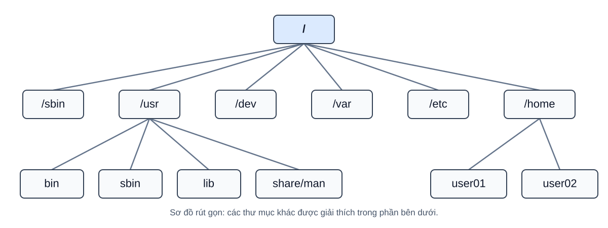

# 2. Hệ thống tệp Linux

[← Mục lục](README.md) · [← Tổng quan](01-tong-quan.md) · [Tiếp: Terminal →](03-terminal.md)

## Hệ thống thư mục Linux

Linux tổ chức tệp và thư mục thành một cây duy nhất bắt đầu từ **`/` (thư mục gốc)**. Mọi đường dẫn tuyệt đối đều bắt đầu bằng `/`, ví dụ `/etc/hosts` hoặc `/home/user01`. Các ổ đĩa và phân vùng khác có thể được gắn (mount) vào một vị trí trong cây này.

| Thư mục | Vai trò chính |
| --- | --- |
| `/` | Thư mục gốc của toàn bộ cây thư mục Linux. |
| `/bin` | Các lệnh cơ bản cần thiết để sử dụng và khôi phục hệ thống. |
| `/boot` | Tệp cần cho quá trình khởi động, như kernel và tệp của bộ nạp khởi động. |
| `/dev` | Các tệp thiết bị, ví dụ ổ đĩa hoặc thiết bị đầu cuối. |
| `/etc` | Tệp cấu hình của hệ thống và các dịch vụ. |
| `/home` | Thư mục cá nhân của người dùng thông thường. |
| `/lib`, `/lib64` | Thư viện cần cho các chương trình hệ thống; `/lib64` có trên một số kiến trúc hoặc bản phân phối. |
| `/opt` | Vị trí dành cho các gói phần mềm cài đặt bổ sung. |
| `/tmp` | Tệp tạm; có thể được dọn dẹp tự động. |
| `/usr` | Phần lớn chương trình, thư viện và dữ liệu dùng chung, như `/usr/bin` và `/usr/share/man`. |
| `/var` | Dữ liệu thay đổi khi hệ thống hoạt động, như log ở `/var/log` và dữ liệu dịch vụ ở `/var/lib`. |
| `/sbin` | Các lệnh thiết yếu để quản trị, khởi động hoặc khôi phục hệ thống. |
| `/root` | Thư mục cá nhân của tài khoản quản trị `root`. |
| `/run` | Dữ liệu thời gian chạy, thường được tạo lại sau mỗi lần khởi động. |
| `/proc`, `/sys` | Hệ thống tệp ảo cung cấp thông tin về tiến trình, kernel và thiết bị. |

**Dễ nhầm:** `/` là gốc của toàn bộ cây thư mục, còn `/root` là thư mục cá nhân của tài khoản `root`. Tệp cá nhân của người dùng thông thường nằm dưới `/home`; `/usr` không phải thư mục cá nhân. `user01` và `user02` trong sơ đồ chỉ là tên ví dụ.

> **Lưu ý:** Trên nhiều bản phân phối Linux hiện nay, `/bin`, `/sbin` và `/lib` là liên kết tượng trưng đến các thư mục tương ứng trong `/usr`. Vì vậy, cây thư mục thực tế có thể khác sơ đồ rút gọn ở trên.

## Các kiểu tệp trong Linux

Để dễ hình dung, có thể chia các mục trong hệ thống tệp thành ba nhóm sau. Đây là cách phân nhóm khái quát; Linux còn phân biệt nhiều kiểu cụ thể hơn.

### Tệp thường (regular file)

Tệp thường lưu dữ liệu như văn bản, mã nguồn, ảnh, video hoặc chương trình. Có thể mở hoặc chỉnh sửa bằng phần mềm phù hợp nếu có quyền truy cập. Ví dụ, `example.txt` là tên một tệp văn bản; phần đuôi `.txt` không quyết định kiểu tệp trong Linux.

### Thư mục (directory)

Thư mục chứa tên của các tệp và thư mục con, giúp sắp xếp dữ liệu thành cây. Ví dụ, thư mục `Documents` trong thư mục cá nhân có thể chứa tài liệu và hình ảnh.

### Tệp đặc biệt (special files)

Tệp đặc biệt đại diện cho thiết bị hoặc phục vụ giao tiếp giữa các tiến trình, như tệp thiết bị, FIFO và socket. Liên kết tượng trưng trỏ đến đường dẫn khác và cũng thuộc nhóm này khi phân loại khái quát. Ví dụ, `/dev/sda` có thể đại diện cho một ổ đĩa; tên thiết bị tùy từng máy.

### Ký hiệu kiểu tệp

Khi xem thông tin chi tiết của một tệp, ký tự đầu tiên cho biết kiểu tệp:

| Ký hiệu | Ý nghĩa |
| --- | --- |
| `-` | Tệp thường (regular file) |
| `d` | Thư mục (directory) |
| `l` | Liên kết tượng trưng (symbolic link) |
| `c` | Thiết bị ký tự (character device) |
| `b` | Thiết bị khối (block device) |
| `s` | Socket |
| `p` | Ống dẫn có tên (named pipe/FIFO) |
| `?` | Không xác định được kiểu tệp |

### Tệp và thư mục ẩn

Trong Linux, tên bắt đầu bằng dấu chấm (`.`) được xem là ẩn khi hiển thị danh sách thông thường. Quy tắc này áp dụng cho cả tệp và thư mục, ví dụ `.bashrc` và `.config`. **Ẩn không có nghĩa là được bảo mật**; quyền truy cập vẫn quyết định ai có thể xem hoặc sửa chúng.

## Đường dẫn (path)

Đường dẫn là chuỗi tên thư mục và tệp dùng để xác định vị trí của một mục trong cây thư mục Linux. Các thành phần được ngăn cách bằng dấu `/`.

### Đường dẫn tuyệt đối (absolute path)

Đường dẫn tuyệt đối bắt đầu từ thư mục gốc `/` và chỉ rõ vị trí của tệp hoặc thư mục, không phụ thuộc vào vị trí đang đứng. Ví dụ, `/home/user/Documents/file.txt` chỉ tệp `file.txt` trong thư mục `Documents` của người dùng `user`.

### Đường dẫn tương đối (relative path)

Đường dẫn tương đối được hiểu dựa trên thư mục hiện tại. Ví dụ, nếu đang ở `/home/user/Documents`, đường dẫn `../Pictures/photo.jpg` chỉ tệp `/home/user/Pictures/photo.jpg`; `..` nghĩa là thư mục cha.
