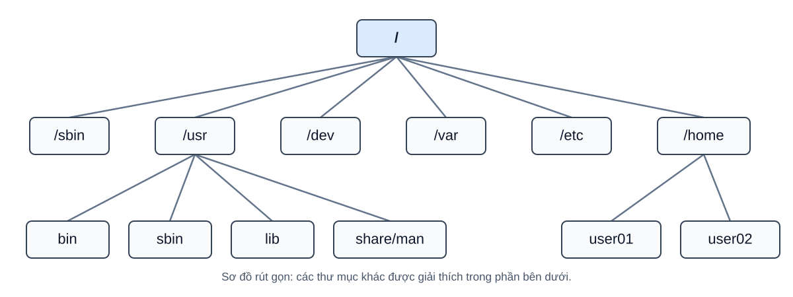

# 2. Hệ thống tệp Linux

[← Mục lục](README.md) · [← Tổng quan](01-tong-quan.md) · [Tiếp: Terminal →](03-terminal.md)

## Hệ thống thư mục Linux

Linux tổ chức tệp và thư mục thành một cây, bắt đầu từ **`/` (thư mục gốc)**. Các ổ đĩa và phân vùng được gắn (mount) vào những vị trí trong cây này.

### Các thư mục thường gặp

| Thư mục | Vai trò chính |
| --- | --- |
| `/` | Gốc của toàn bộ cây thư mục. |
| `/home` | Thư mục cá nhân của người dùng; mã nguồn có thể nằm ở `/home/user01/project`. |
| `/root` | Thư mục cá nhân của tài khoản quản trị `root`. |
| `/etc` | Cấu hình của hệ thống và dịch vụ, như cấu hình Nginx trong `/etc/nginx`. |
| `/bin`, `/sbin` | Các lệnh cơ bản và lệnh quản trị hệ thống. |
| `/usr` | Phần lớn chương trình, thư viện và dữ liệu dùng chung. |
| `/lib`, `/lib64` | Thư viện phục vụ các chương trình hệ thống. |
| `/var` | Dữ liệu thay đổi khi hệ thống hoạt động, như log trong `/var/log`. |
| `/tmp` | Tệp tạm. |
| `/opt` | Phần mềm cài đặt bổ sung. |
| `/boot` | Các tệp cần để khởi động hệ điều hành. |
| `/dev` | Tệp đại diện cho thiết bị, như ổ đĩa hoặc terminal. |
| `/run` | Dữ liệu phục vụ các chương trình đang chạy, như tệp lưu mã tiến trình. |
| `/proc`, `/sys` | Thông tin do kernel cung cấp về tiến trình, thiết bị và hệ thống. |

**Phân biệt:** `/` là thư mục gốc; `/root` là thư mục cá nhân của tài khoản `root`. `/usr` chứa chương trình và dữ liệu dùng chung, còn thư mục cá nhân của người dùng thường nằm trong `/home`.

## Các kiểu tệp trong Linux

Khi xem danh sách bằng lệnh `ls -l`, ký tự đầu tiên trên mỗi dòng thông tin cho biết kiểu tệp:

| Ký hiệu | Kiểu tệp | Ý nghĩa |
| --- | --- | --- |
| `-` | Tệp thường (regular file) | Lưu văn bản, mã nguồn, ảnh hoặc chương trình. |
| `d` | Thư mục (directory) | Chứa tệp và thư mục con. |
| `l` | Liên kết tượng trưng (symbolic link) | Trỏ đến một đường dẫn khác. |
| `c` | Thiết bị ký tự (character device) | Tệp đại diện cho thiết bị như terminal. |
| `b` | Thiết bị khối (block device) | Tệp đại diện cho thiết bị lưu trữ như ổ đĩa. |
| `s` | Socket | Dùng để các tiến trình giao tiếp trên cùng máy. |
| `p` | Ống dẫn có tên (FIFO) | Truyền dữ liệu giữa các tiến trình theo thứ tự vào trước, ra trước. |

Ba kiểu thường gặp khi thao tác với dữ liệu là **tệp thường, thư mục và liên kết tượng trưng**. Phần đuôi tên như `.txt` hoặc `.jpg` không quyết định kiểu tệp ở bảng trên.

### Tệp và thư mục ẩn

Tệp hoặc thư mục có tên bắt đầu bằng dấu chấm (`.`) sẽ không hiện khi chạy `ls` thông thường. Ví dụ: `.bashrc`, `.git`, `.config`. Dùng `ls -a` để xem cả các mục ẩn.

## Đường dẫn (path)

**Đường dẫn** cho biết vị trí của tệp hoặc thư mục. Các thành phần được ngăn cách bằng dấu `/`.

Tên tệp thường phân biệt chữ hoa và chữ thường: `README.md` và `readme.md` là hai tên khác nhau.

Giả sử bạn đang ở thư mục `/home/user01/Documents`:

| Loại đường dẫn | Cách xác định vị trí | Ví dụ |
| --- | --- | --- |
| Tuyệt đối (absolute path) | Bắt đầu bằng `/`, tính từ thư mục gốc. | `/home/user01/Documents/notes.txt` |
| Tương đối (relative path) | Không bắt đầu bằng `/`, tính từ thư mục hiện tại. | `notes.txt` |

Trong ví dụ này, hai đường dẫn trên cùng chỉ đến một tệp.

### Các ký hiệu thường dùng

| Ký hiệu | Ý nghĩa | Ví dụ |
| --- | --- | --- |
| `.` | Thư mục hiện tại. | `./notes.txt` |
| `..` | Thư mục cha, nằm trên một cấp. | `../Pictures/photo.jpg` |
| `~` | Thư mục cá nhân của người dùng khi gõ lệnh trong shell. | `~/Documents/notes.txt` |

Nếu đang ở `/home/user01/Documents`, đường dẫn `../Pictures/photo.jpg` chỉ đến `/home/user01/Pictures/photo.jpg`.
