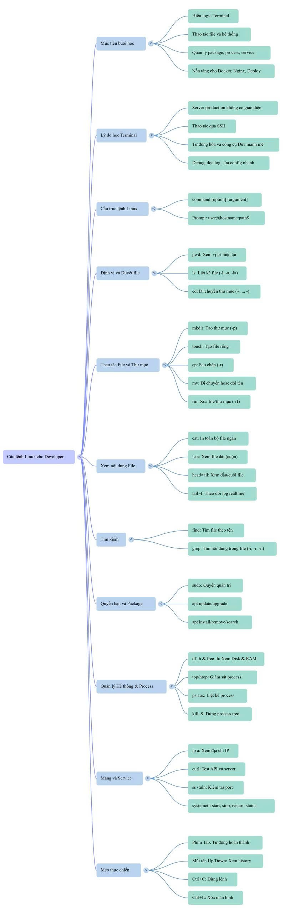

# Linux căn bản cho Software Engineer

Ứng dụng thường chạy trên Linux. Bộ ghi chú này giúp bạn hiểu môi trường chạy ứng dụng và dùng các lệnh cơ bản để làm việc với tệp, thư mục và hệ thống.

## Học theo thứ tự

| Bài | Nội dung | Đọc khi cần |
| --- | --- | --- |
| [1. Tổng quan Linux](01-tong-quan.md) | OS, kernel, distro, kiến trúc, máy ảo | Hiểu Linux gồm những gì. |
| [2. Hệ thống tệp](02-he-thong-tep.md) | Cây thư mục, kiểu tệp, đường dẫn | Tìm và hiểu vị trí tệp. |
| [3. Terminal](03-terminal.md) | Dấu nhắc, cú pháp, phím tắt, `history`, `clear`, `man` | Hiểu dòng lệnh và xem lại thao tác đã làm. |
| [4. Điều hướng](04-dieu-huong.md) | `pwd`, `cd`, `ls`, `tree`, `du`, `df` | Kiểm tra đúng project, xem thư mục và dung lượng đĩa. |
| [5. Tệp và thư mục](05-tep-va-thu-muc.md) | Thao tác tệp, `nano`, `find`, `grep`, `tail -f` | Sửa cấu hình, đọc log và debug backend. |
| [6. Quyền và gói](06-quyen-va-goi.md) | `sudo`, `chmod`, `chown`, APT, `passwd` | Sửa lỗi quyền truy cập và cài phần mềm. |
| [7. Kiểm tra hệ thống](07-kiem-tra-he-thong.md) | Tài khoản, CPU/RAM, `ps`, `kill`, `systemctl`, log dịch vụ | Tìm backend đang chạy và quản lý dịch vụ. |
| [8. IP và kết nối mạng](08-mang-va-ket-noi.md) | `hostname -I`, `ip a`, `ping`, `ss`, `curl`, SSH/SCP | Kiểm tra kết nối và làm việc với server. |
| [9. Shell script](09-shell-script.md) | Shebang, cách chạy `.sh`, script kiểm tra server và tạo project | Tự động hóa các thao tác lặp lại. |

**Cách dùng:** Người mới nên đọc theo thứ tự. Khi cần tra cứu, chọn bài trong bảng. Kiểm tra đường dẫn trước khi chạy lệnh thay đổi hoặc xóa dữ liệu.

## Bài thực hành

Bài tập buổi 7 — câu lệnh Linux cho developer. Mỗi bài có lệnh, kết quả và ảnh minh chứng. Theo dõi chung tại [issue #10](https://github.com/tavt-dev/software-engineer-fullstack/issues/10).

| Bài làm | Issue |
| --- | --- |
| [1. Tạo môi trường project](exercise/01-tao-moi-truong-project.md) | [#12](https://github.com/tavt-dev/software-engineer-fullstack/issues/12) |
| [2. Quản lý tệp trong backend](exercise/02-quan-ly-tep-trong-backend.md) | [#13](https://github.com/tavt-dev/software-engineer-fullstack/issues/13) |
| [3. Tạo và đọc log](exercise/03-tao-va-doc-log.md) | [#14](https://github.com/tavt-dev/software-engineer-fullstack/issues/14) |
| [4. Tìm kiếm trong project](exercise/04-tim-kiem-trong-project.md) | [#15](https://github.com/tavt-dev/software-engineer-fullstack/issues/15) |
| [5. Kiểm tra công cụ dev](exercise/05-kiem-tra-cong-cu-dev.md) | [#16](https://github.com/tavt-dev/software-engineer-fullstack/issues/16) |
| [6. Kiểm tra máy Ubuntu](exercise/06-kiem-tra-may-ubuntu.md) | [#17](https://github.com/tavt-dev/software-engineer-fullstack/issues/17) |
| [7. Kiểm tra mạng và cổng](exercise/07-kiem-tra-mang-va-cong.md) | [#18](https://github.com/tavt-dev/software-engineer-fullstack/issues/18) |

## Tài liệu PDF

- [Linux cheatsheet (PDF)](tai-lieu/linux-cheatsheet.pdf)

## Sơ đồ tổng hợp lệnh Linux

Khi dừng tiến trình, kiểm tra đúng PID và dùng `kill PID` trước; chỉ dùng `kill -9 PID` khi tiến trình không dừng bằng cách thông thường.
