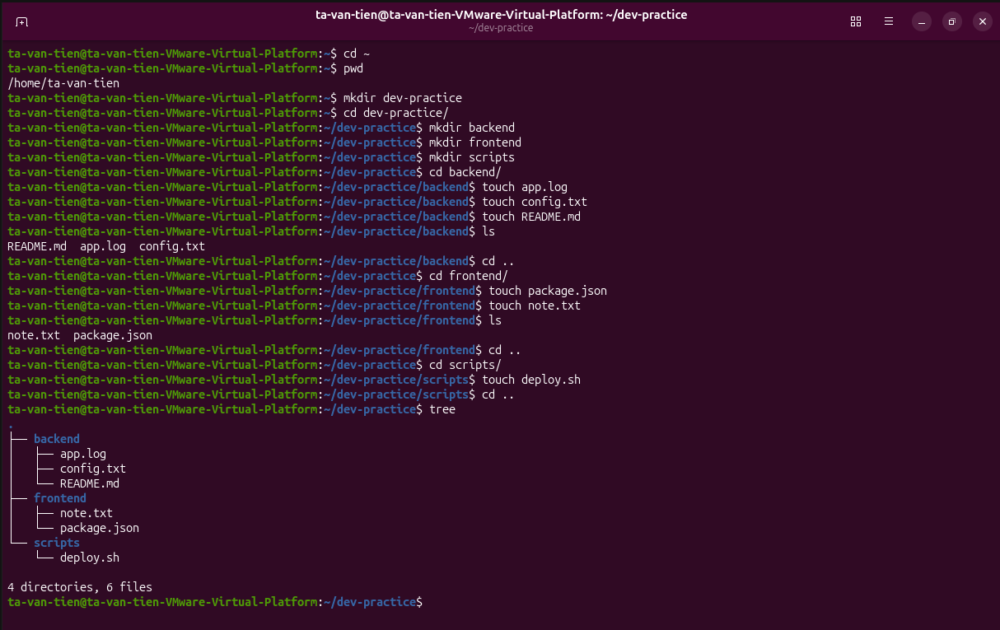

# Bài tập 01: Tạo môi trường project

> GitHub issue: [#12 — Tạo môi trường project](https://github.com/tavt-dev/software-engineer-fullstack/issues/12)

```bash
cd ~
mkdir dev-practice
cd dev-practice
mkdir backend frontend scripts
touch backend/app.log backend/config.txt backend/README.md
touch frontend/package.json frontend/note.txt scripts/deploy.sh
tree
```

**Kết quả:** tạo đủ 3 thư mục và 6 tệp trong `~/dev-practice`.


