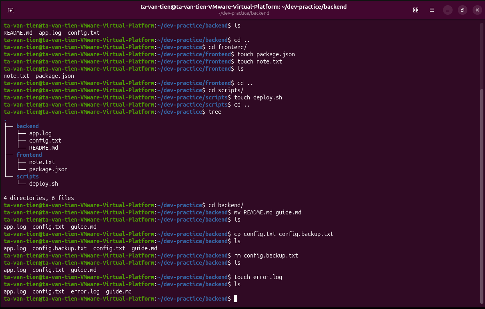

# Bài tập 02: Quản lý tệp trong backend

> GitHub issue: [#13 — Quản lý tệp trong backend](https://github.com/tavt-dev/software-engineer-fullstack/issues/13)

```bash
cd ~/dev-practice/backend
mv README.md guide.md
cp config.txt config.backup.txt
rm config.backup.txt
touch error.log
ls
```

**Kết quả:** còn `app.log`, `config.txt`, `error.log` và `guide.md`.


