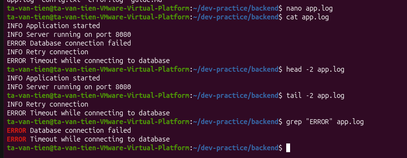

# Bài tập 03: Tạo và đọc log

> GitHub issue: [#14 — Tạo và đọc log](https://github.com/tavt-dev/software-engineer-fullstack/issues/14)

## Câu hỏi

- Dùng nano ghi 5 dòng log mẫu vào `backend/app.log`.
- Xem toàn bộ tệp, 2 dòng đầu và 2 dòng cuối.
- Tìm các dòng chứa `ERROR`.

## Câu trả lời

Mở tệp bằng nano:

```bash
cd ~/dev-practice/backend
nano app.log
```

Ghi nội dung sau, lưu bằng `Ctrl + O`, nhấn `Enter`, rồi thoát bằng `Ctrl + X`:

```text
INFO Application started
INFO Server running on port 8080
ERROR Database connection failed
INFO Retry connection
ERROR Timeout while connecting to database
```

Đọc và lọc log:

```bash
cat app.log
head -n 2 app.log
tail -n 2 app.log
grep "ERROR" app.log
```

| Lệnh | Kết quả |
| --- | --- |
| `cat app.log` | Hiển thị đủ 5 dòng |
| `head -n 2 app.log` | Hiển thị 2 dòng đầu về khởi động ứng dụng và port `8080` |
| `tail -n 2 app.log` | Hiển thị 2 dòng cuối về thử kết nối lại và lỗi timeout |
| `grep "ERROR" app.log` | Tìm được 2 dòng lỗi kết nối database |

Trong ảnh, `head -2` và `tail -2` cho cùng kết quả với cách viết `head -n 2` và `tail -n 2` ở trên.

Đây là log mẫu mình tự nhập để luyện lệnh đọc và tìm lỗi.


