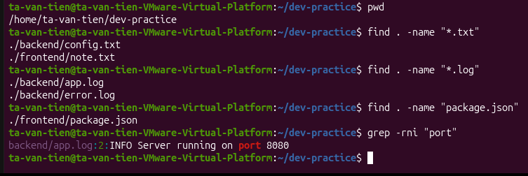

# Bài tập 04: Tìm kiếm trong project

> GitHub issue: [#15 — Tìm kiếm trong project](https://github.com/tavt-dev/software-engineer-fullstack/issues/15)

```bash
cd ~/dev-practice
find . -name "*.txt"
find . -name "*.log"
find . -name "package.json"
grep -rni "port" .
```

**Kết quả:** tìm được `config.txt`, `note.txt`, `app.log`, `error.log` và `frontend/package.json`. Từ khóa `port` nằm ở dòng 2 của `backend/app.log`.


