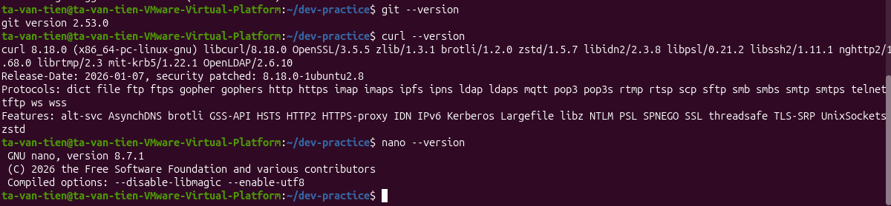

# Bài tập 05: Kiểm tra công cụ dev

> GitHub issue: [#16 — Kiểm tra công cụ dev](https://github.com/tavt-dev/software-engineer-fullstack/issues/16)

```bash
git --version
curl --version
nano --version
```

**Kết quả:** Git `2.53.0`, curl `8.18.0`, nano `8.7.1`; cả ba công cụ đều dùng được.


