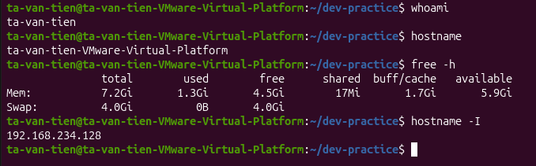

# Bài tập 06: Kiểm tra máy Ubuntu

> GitHub issue: [#17 — Kiểm tra máy Ubuntu](https://github.com/tavt-dev/software-engineer-fullstack/issues/17)

## Câu hỏi

- Dùng lệnh xác định user hiện tại, hostname, dung lượng RAM và IP nội bộ.
- Ghi lại kết quả kiểm tra.

## Câu trả lời

```bash
whoami
hostname
free -h
hostname -I
```

| Thông tin | Lệnh | Kết quả trong ảnh |
| --- | --- | --- |
| User hiện tại | `whoami` | `ta-van-tien` |
| Tên máy | `hostname` | `ta-van-tien-VMware-Virtual-Platform` |
| RAM | `free -h` | Tổng `7.2 GiB`, đang dùng `1.3 GiB`, khả dụng khoảng `5.9 GiB` |
| Swap | `free -h` | Tổng `4.0 GiB`, đang dùng `0 B` |
| IP nội bộ | `hostname -I` | `192.168.234.128` |

`free -h` hiển thị bộ nhớ theo đơn vị dễ đọc. Cột `available` là lượng RAM ước tính còn có thể dùng cho ứng dụng mới. Các số liệu RAM và địa chỉ IP có thể thay đổi ở lần kiểm tra sau.


