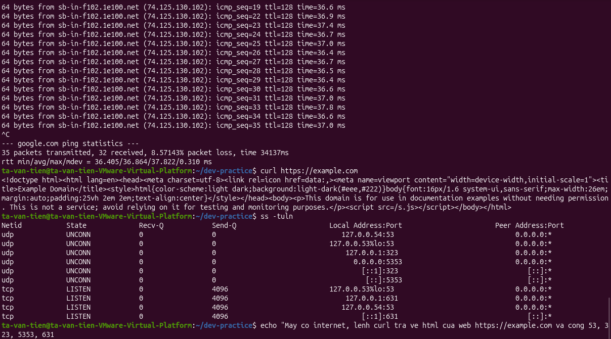

# Bài tập 07: Kiểm tra mạng và cổng

> GitHub issue: [#18 — Kiểm tra mạng và cổng](https://github.com/tavt-dev/software-engineer-fullstack/issues/18)

```bash
ping google.com
# Nhấn Ctrl + C để dừng ping.
curl https://example.com
ss -tuln
```

**Kết quả:**

- Có Internet: ping nhận `32/35` gói, mất khoảng `8,57%`; curl lấy được trang web.
- curl trả về mã HTML của trang **Example Domain**.
- TCP đang lắng nghe ở cổng `53`, `631`; UDP có các cổng `53`, `323`, `5353`.


