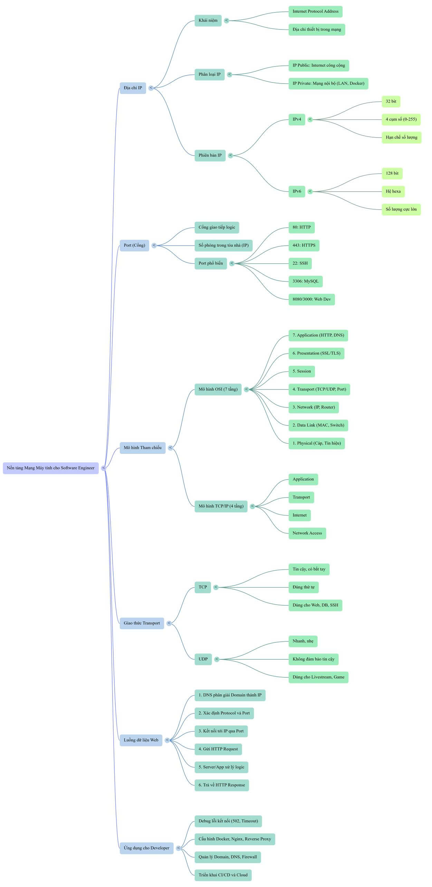
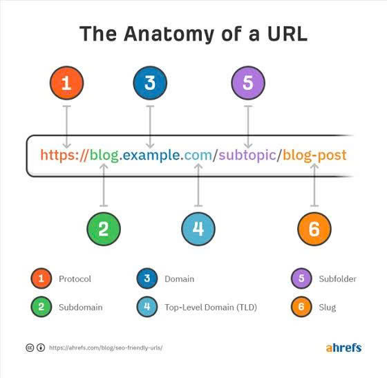
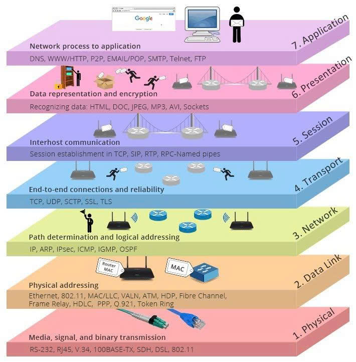

# Mạng máy tính

## 1. IP là gì

IP là địa chỉ của 1 thiết bị trong mạng

Ví dụ:

- laptop của các em có IP
- điện thoại của các em có IP
- router wifi có ip
- server ngoài internet có IP

Ngoài đời, muốn gửi hàng cho ai thì phải có địa chỉ nhà. Trong thế giới mạng cũng vậy, muốn máy tính gửi dữ liệu cho 1 máy tính khác, muốn điện thoại xem được youtube, muốn trình duyệt gọi API, thì phải biết dữ liệu sẽ đi tới đâu. Cái "đầu" đó chính là địa chỉ IP

## 2. IP Public

là địa chỉ IP dùng ngoài internet công cộng, đây là loại IP mà thiết bị bên ngoài internet có thể nhìn thấy và truy cập tới

Ví dụ: VPS, Server, AWS, cloud, API public, web server, hosting

IP private là địa chỉ IP dùng trong mạng nội bộ, không dùng để truy cập trực tiếp từ internet công cộng

Ví dụ:

- 192.168.x.x
- 10.x.x.x
- 172.16.x.x đến 172.31.x.x

cmd -> ipconfig

ví dụ: mạng wifi công ty, mạng gia đình, mạng nội bộ docker, mạng nội bộ cloud

## 3. IPv4 là gì

IPv4 là phiên bản địa chỉ IP truyền thống, và hiện nay vẫn đang được dùng rất rộng rãi, nhìn thấy IPv4 rất quen vì nó dạng như:

- 1.1.1.1
- 8.8.8.8
- 192.168.99.31

Nó được viết dưới dạng 4 cụm số, ngăn cách bằng dấu chấm. Mỗi cụm có giá trị từ 0->255. Điều đó khiến số lượng địa chỉ có giới hạn, tổng cộng có hơn 4 tỷ địa chỉ IPv4

IPv6 ra đời để giải quyết vấn đề lớn nhất của IPv4 đó là thiếu địa chỉ

IPv6 cũng là địa chỉ mạng, là thế hệ mới, sinh ra vì IPv4 k đủ nữa và trong tương lai sẽ gặp ngày càng nhiều hơn

Domain không phải IP

IP là địa chỉ  mạng thật của máy

Domain là tên dễ nhớ cho con người

Con người thích nhớ tên miền vì nó dễ nhớ, nhưng máy tính thì cần IP để kết nối thật sự.

DNS làm nhiệm vụ chuyển từ domain sang IP

Khi Tiến gõ facebook.com, trình duyệt không thể kết nối tới chữ "facebook.com" theo nghĩa vật lý. Nó phải hỏi DNS để biết tên đó đang tương nng với IP nào, rồi mới đi tiếp

Hình dung: ip là số nhà cụ thể, domain là tên công ty, DNS là quyển sổ tra cứu để xem công ty đó ở số nhà nào

## 3. Port

Nếu IP là địa chỉ của tòa chung cư thì port là số phòng trong tòa đó

1 server có thể có 1 IP nhưng trên đó chạy rất nhiều dịch vụ khác:

- webserver
- db
- ssh
- redis

Nếu tất cả cùng dùng chung 1 địa chỉ mà k phân biệt cách kết nối thì hệ thống sẽ không biết user muốn vào dịch vụ nào. Lúc này port giúp phân chi các dịch vụ đó

Port 80: Dùng cho HTTP, tức là web không mã hóa

Port 443: Dùng cho HTTPS, tức là web có SSL/TLS

Port 22: Dùng cho SSH, để truy cập server Linux từ xa

Port 53: Dùng cho DNS

Port 3306: Dùng cho cơ sở dữ liệu (database)

Port 6379: Redis

Port 3000: Hay gặp cho fe(reactj, nextjs)

Port 8080: Dùng cho be (java, c#, python,...)

Port 9090: Hay gặp trong việc monitoring (giám sát an ninh mạng)

-> Nhìn thấy là phải hiểu ngay nó liên quan đến dịch vụ

Phân biệt IP, port, domain, URL

RÕ:

IP là địa chỉ của máy trong mạng

Port là cổng dịch vụ trên máy đó

ví dụ: 8087

Domain là tên miền dễ nhớ: hotrodoan.vn

URL:Là địa chỉ truy cập đầy đủ

Ví dụ: https://hotrodoan.vn:443/login

trong URL này có:

- https là protocol
- hotrodoan.vn là domain
- 443 là port
- /login là path

## OSI

và OSI là 1 mô hình 7 tầng, dùng để mô tả cách dữ liệu đi từ ứng dụng xuống mạng, truyền đi rồi sang bên kia và được mở ra lại

-> Khi dữ liệu đi từ app của mình ra ngoài mạng, nó không đi thẳng 1 phát từ code sang internet, nó đi qua nhiều lớp. Mỗi lớp có trách nhiệm khác nhau

### Tầng 7 - Application

Đây là tầng gần ứng dụng nhất, là nơi các em hay chạm vào nhất

Ví dụ: trình duyệt, postman, app mobile, http, https, dns

Khi các em viết FE gọi API, khi BE trả Json, khi postman gửi request

là các em đang chạm vào tầng này

### Tầng 6 - Presentation

tầng này liên quan đến cách dữ liệu được biểu diễn

- mã hóa, giải mã, nén, định dạng

Các em có thể liên tưởng tới JSON, SSL/TLS ở góc nhìn dữ liệu được mã hóa hoặc biểu diễn ra sao

### tầng 5 - session

quản lý phiên giao tiếp giữa 2 bên

### Tầng 4 - Transport

Tầng quan trọng với Dev

tầng này liên quan đến

- TCP
- UDP
- port

Khi các em nghe nói "service listen ở port 8080", "kết nối tới port 3306" "TCP timeout" đó là những thứ thuộc tầng này

### Tầng 3 - Network

IP, định tuyến, router và chuyển các gói tin qua các mạng khác nhau IPv4 và IPv6 nằm ở đây

### Tầng 2 - Data Link

Liên quan nhiều tới MAC address, switch trong cùng 1 mạng nội bộ

ipconfig -all

### Tầng 1- Physical

Là phần vật lý:

- dây mạng
- sóng wifi
- thiết bị truyền dẫn

Nên các em sẽ thấy dữ liệu thật sự đi ra rất nhiều lớp trước khi tới được server

NHỚ: Càng lên trên thì càng gần tầng ứng dụng

càng xuống thấp càng gần mạng và phần cứng

## 2. TCP và UDP

TCP là giao thức truyền dữ liệu tin cậy

Nó có đặc điểm:   có thiết lập kết nối   đảm bảo dữ liệu đúng thứ tự   có cơ chế kiểm tra và gửi lại nếu mất

SSH, API, MYSQL, HTTP/HTTPS

UDP thì nhanh hơn, nhẹ hơn, nhưng không đảm bảo như TCP

nó phù hợp với các tình huống cần tốc độ và chấp nhận mất dữ liệu

ví dụ: livestream, video call, game online

giả sử Kiên mở trình duyệt cốc cốc và truy cập vào trang 2010.com -> request web đi như thế nào?

Bước 1: Trình duyệt hỏi DNS

Trình duyệt cần biết 2010.com tương ứng với IP nào

Bước 2: Nhìn vào protocol

Ở đây là https, tức là sẽ đi qua port 443

Bước 3: Kết nối tới IP và port tương ứng

Tức là trình duyệt sẽ cố gắng mở kết nối tới server đó qua port 443

Bước 4: Nếu là HTTPS, sẽ có bắt tay TLS

Bắt tay 3 bước, đây là lớp bảo mật để mã hóa kết nối

Bước 5: Trình duyệt gửi HTTP request

Ví dụ: GET, POST, kèm header, cookie hoặc token nếu có

Bước 6: Server nhận request

Server này có thể là: nginx, spring boot, apache,.. (webserver)

Bước 7: web app xử lý logic

đọc request, kiểm tra auth, gọi database, xử lý nghiệp vụ, tạo response

Bước 8: Response trả về trình duyệt

Trình duyệt nhận dữ liệu HTML, CSS, JS VÀ JSON
